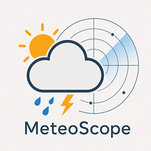
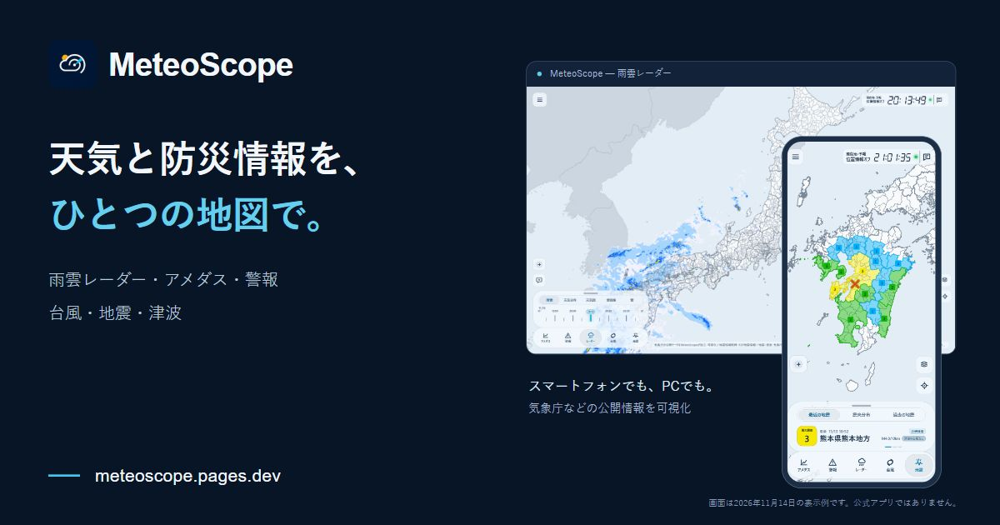
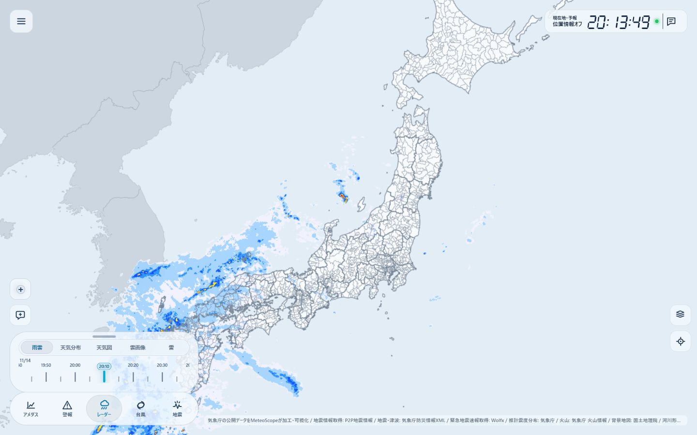
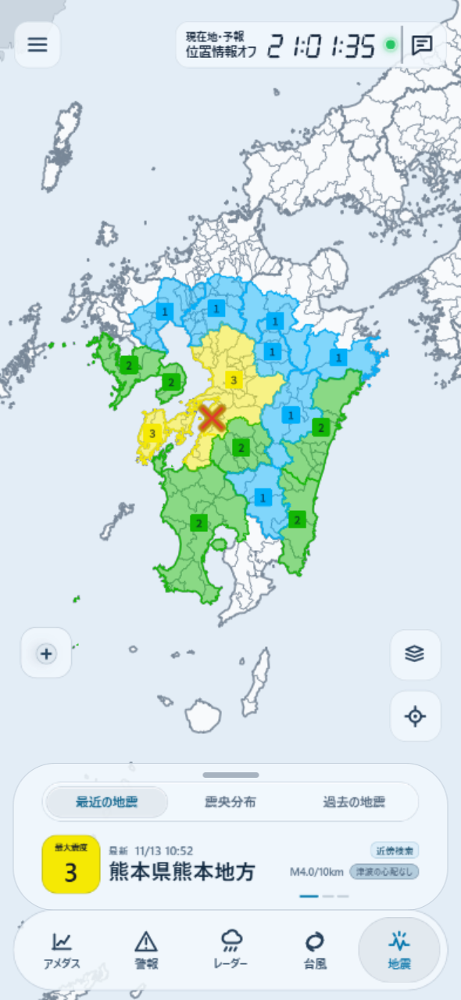
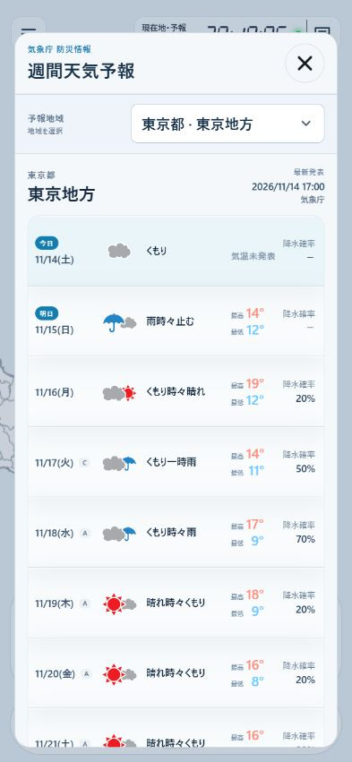

  

# MeteoScope

**天気と防災情報を、ひとつの地図で。**

雨雲、アメダス、警報・注意報、台風、地震・津波を地図上で確認できるWebアプリです。スマートフォンでもパソコンでも、知りたい情報を切り替えながら、地域ごとの状況と詳しい発表内容を見られます。

**[MeteoScopeを開く](https://meteoscope.pages.dev/)** · [更新履歴](CHANGELOG.md) · [データの出典](DATA_SOURCES.md)

[X投稿用の横長紹介画像](https://meteoscope.pages.dev/social/meteoscope-x-banner.jpg)（1200 × 630px）

> 気象庁などの公開情報を取得・加工して表示する非公式アプリです。災害時の判断には、最新の公式発表や自治体の避難情報も確認してください。

## 何が見られる？

| 表示 | 確認できる情報 |
| --- | --- |
| **レーダー** | 雨雲の動き、天気分布、天気図、雲画像、雷 |
| **アメダス** | 気温・降水量・風速・湿度・気圧・積雪、観測点のグラフとランキング |
| **警報** | 市区町村別の警報・注意報、早期注意情報、キキクル、指定河川の洪水情報 |
| **台風** | 気象庁の台風情報、進路・予報円・風の範囲、海外モデルの資料 |
| **地震** | 最近の地震、各地の観測震度、震央分布、津波・潮位、火山情報 |

一部の検索・解析・速報機能は[アーリーアクセス](#アーリーアクセス)です。通常公開の情報を見るために、MeteoScopeアカウントを作る必要はありません。

## 画面イメージ

<table>
  <tr>
    <td align="center"> <strong>地震・震度</strong></td>
    <td align="center"> <strong>週間天気予報</strong></td>
  </tr>
</table>

画像は2026年11月14日に、開発環境の実画面を撮影したものです。一部に先行機能のボタンを含みます。表示されている日時・数値・発表内容は撮影時点のもので、現在の状況を示すものではありません。

## 日々の天気を確かめる

### 雨雲・天気図・雲画像

雨雲レーダーは、過去の観測から先の予測までを連続して表示します。時刻スライダーと再生機能で雨雲の動きを追えます。

同じ地図で、天気・気温・降雪量の天気分布予報、天気図、雲画像、雷へ切り替えられます。雲画像には天気図や雨雲を重ねることもできます。

### アメダス

全国の観測点を、気温・降水量・風速・湿度・気圧・積雪で色分けします。観測点ごとの変化はグラフで、地域間の違いはランキングで確認できます。ランキングから選んだ地点も、地図とグラフへ連動します。

気温のグラフには、取得できる地点で平年の最高・最低気温を表示します。観測項目やグラフの有無は地点・データの提供状況によって異なります。

### 週間天気予報

全国の予報地域ごとに、天気アイコン、最高・最低気温、降水確率をまとめて表示します。提供されている日には3時間ごとの天気・気温・風も確認できます。

時計横には、現在地の3時間予報、または今日の予報をアイコンで表示します。これは実況の天気ではなく予報です。位置情報を使わない場合も、週間天気予報の地域は選べます。

## 災害に関する発表を確認する

### 警報・注意報と河川情報

市区町村ごとの発表状況を地図の色と一覧で確認できます。地域の詳細には、発表内容や更新時刻、取得できる時間帯別の見通しを表示します。

早期注意情報、土砂・浸水キキクル、指定河川洪水予報にも対応しています。情報ごとに対象範囲や更新時刻が異なるため、それぞれの発表内容を確認できます。

### 台風と海外モデル

気象庁の台風情報では、中心位置、過去の経路、予報円、予想進路中心線、強風域・暴風域・暴風警戒域を表示します。中心気圧や風速などの解析値・予報値も確認できます。

「海外モデル」ではECMWF・NOAAなどの数値予報モデル資料を比較できます。提供元や基準時刻を区別し、元データにある時刻の経路を表示します。独自の平均経路や発達確率、補間した気圧・風速の予報は提示しません。海外モデル資料は、気象庁の台風情報とは別の参考資料です。

### 地震・津波・火山

最近の地震について、発生時刻、震源地、規模、深さ、観測最大震度と各地の観測震度を表示します。地図では、**細分区域の最大震度は四角いマーカー、各地の震度は丸いマーカー**で区別します。情報が未確定の項目は「調査中」と表示します。

推計震度分布が提供される地震では、その分布も表示できます。発震機構の解析結果がある地震には気象庁・USGSの資料を掲載し、両方ある場合は切り替えて比較できます。

震央分布では、日付や地図で囲った範囲をもとに地震の分布を確認できます。主要活断層、プレート境界・等深線、震央の立体表示を重ねられます。気象研究所の等深線は平面表示です。

津波は、警報・注意報・予報、予報区ごとの予想高さ・到達予想、沿岸・沖合の観測情報を表示します。火山は、選択した火山の噴火警戒レベルや警戒事項を確認できます。

**観測震度・推計震度・EEWの予想震度は別の情報です。** また、地震情報の「津波の心配なし」はその地震の発表に関する説明であり、別の地震に対する津波警報の解除を意味しません。

## 地域の様子を共有する

天気や積雪の様子、桜、紅葉、周辺の危険を、短い文章と選択項目で投稿できます。投稿は雨雲表示の地図に重なり、近い位置に集まっている場合も個別に内容を確認できます。写真の投稿機能はありません。

- **投稿にはMeteoScopeアカウントへのログインが必要**です。アーリーアクセスの許可は不要です。
- 投稿の表示期間は**12時間**。期限後は表示対象から外れ、保存データも順次自動削除されます。自分の投稿はログイン中に削除できます。
- 投稿は**5分に1回・1日12回まで**。日次回数は日本時間9時にリセットされます。
- 投稿位置は約2km単位に丸めます。正確な位置をサーバーへ送信・保存しません。
- 投稿の表示はレイヤー設定で切り替えられます。利用者の投稿であり、公的機関による観測や安全の確認ではありません。

## 地図以外にも

| 機能 | 内容 |
| --- | --- |
| **防災情報まとめ** | 防災に関する情報をまとめて確認 |
| **防災マップ** | 自治体のハザードマップへのリンクと、端末内のPDF・画像の表示 |
| **災害の年表** | 地震・津波、火山、風水害、雪害の主な記録 |
| **過去の気象災害** | 気象庁が掲載する過去の事例と、当時の情報へのリンク |
| **雲の分類図鑑** | 写真と解説で雲の形・特徴・でき方を確認 |
| **高層天気図リンク集** | 最新の実況・予報天気図と、過去の保存用高層天気図 |
| **気象の数値計算** | 数式・単位・適用条件を確認しながら計算。入力値は端末内で処理 |
| **宇宙・気象クイズ** | 難易度を選んで学習。アカウントで共有ランキングにも参加可能 |
| **画像共有** | 地震・台風情報やアメダスランキングから共有用PNGを作成 |
| **時計表示モード** | 時計と全国の天気予報を大きく表示 |

自治体のハザードマップは、国土地理院「わがまちハザードマップ」の掲載情報から探し、自治体などのページを別タブで開きます。掲載がない地域やリンク先の変更もあるため、すべての自治体・災害種類を網羅するものではありません。

## アーリーアクセス

開発中の機能を先行して利用できる仕組みです。公開版では、**MeteoScopeアカウントへのログインと管理者の許可**が必要です。アカウント登録だけで自動的に有効になるものではありません。

| 先行機能 | 内容 |
| --- | --- |
| **緊急地震速報（EEW）** | Wolfxから受信した予報・警報、対象地域の予想震度、P波・S波の概算表示 |
| **防災チャット** | 気象庁の気象・地震・津波情報や、用語・一般的な避難行動について質問 |
| **過去の地震検索** | 期間や震度などの条件、震源付近、地図で囲った範囲による検索 |
| **アメダスの前日グラフ** | 観測点の今日と前日の変化を比較 |
| **天気図の期間拡張** | 過去7日分の天気図を表示 |
| **高層気象** | 高層観測のエマグラム・風の解析とGFS地点モデル |

EEWは通信状態や配信元の状況により遅延・欠落する場合があります。P波・S波はJMA2001走時表に基づく概算で、気象庁の正式な到達時刻予測ではありません。仮定震源要素など、適切に計算できない速報では到達円を表示しません。アプリを閉じている間のEEWプッシュ通知には対応していません。

防災チャットは**Gemma 4による説明・翻訳**と、気象庁資料からの直接回答を使います。1アカウント1日10回までで、日本時間9時に回数をリセットします。サービス側のAI利用枠に達した場合も受付を停止します。AIの回答は誤ることがあり、自治体の避難指示・避難所の開設状況・安全な避難経路を確認する機能ではありません。

## 自分に合う表示に

ライト・ダークの配色、日本語・英語の表示、マイエリア、タブの並び順、地図の重ね合わせなどを設定できます。地形や主要なレイヤーの設定は、次回起動時にも引き継がれます。海外モデルの表示選択は保存対象外です。

スマートフォンでは、地図を広く使える要約表示と詳しい情報のパネルを使い分けられます。ブラウザが対応していればホーム画面に追加して利用できます。位置情報は必須ではなく、使わない場合も地図移動や地域選択で情報を確認できます。

お知らせ通知は運営からの案内向けです。地震・警報・EEWを常時バックグラウンド監視して通知する機能ではありません。

## データとプライバシー

| 情報 | 主な取得元 |
| --- | --- |
| 気象・警報・台風・津波・火山 | 気象庁の公開データ・防災情報XML |
| 最近の地震のリアルタイム受信 | P2P地震情報。確定値の照合・詳細・履歴や受信障害時に気象庁XMLを併用 |
| 緊急地震速報 | Wolfx Open API |
| 海外台風モデル | ECMWF・NOAAなど |
| 発震機構 | 気象庁・USGS |
| 地図・地形・ハザードマップ案内 | 気象庁・国土地理院など |
| 活断層・プレート | J-SHIS、USGS、気象研究所など。資料ごとに表示範囲・条件が異なる |

取得元、加工内容、利用条件の詳細は[データ出典一覧](DATA_SOURCES.md)にまとめています。

チャットの質問と直近の会話は、回答のためCloudflare Workers AIへ送信します。個人情報を入力しないでください。詳細は[利用規約](https://meteoscope.pages.dev/terms.html)・[プライバシーポリシー](https://meteoscope.pages.dev/privacy.html)で確認できます。

通信断、配信元の障害、ブラウザの制限などにより、表示の遅延や一部機能を利用できない場合があります。発表時刻・対象地域・取得状態を確認し、情報が取得できない状態を「発表なし」「安全」と読み替えないでください。

---

### 関連資料

[更新履歴](CHANGELOG.md) · [データ出典](DATA_SOURCES.md) · [開発・保守](docs/maintenance.md) · [防災チャットの仕様](docs/warning-chat.md) · [ハザードマップの掲載方針](docs/municipal-hazard-maps.md)
